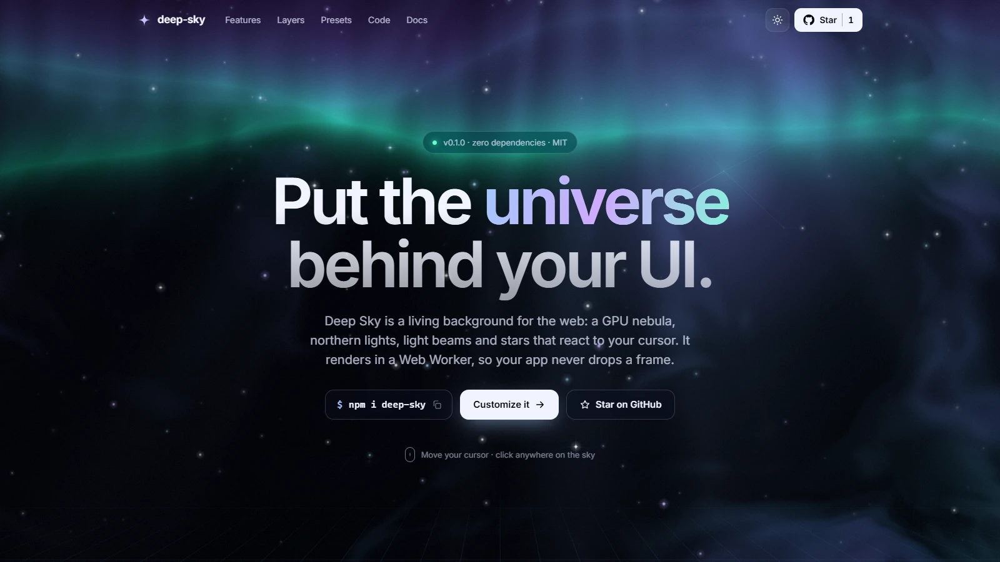
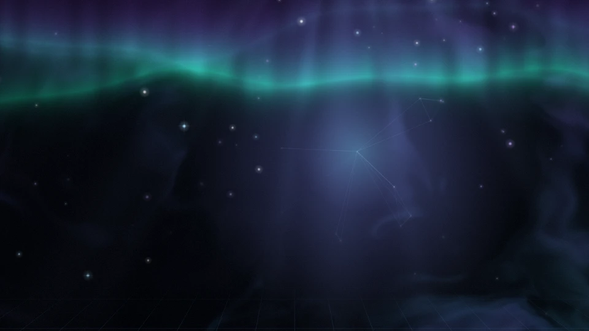
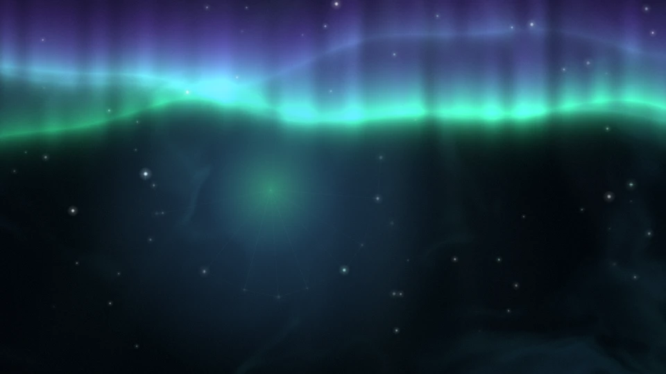
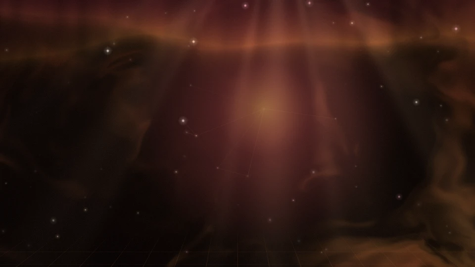
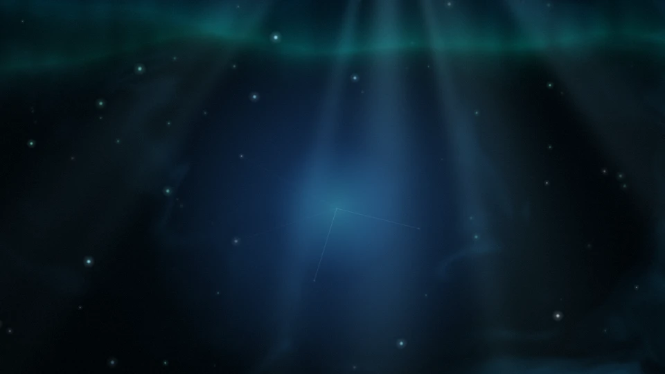
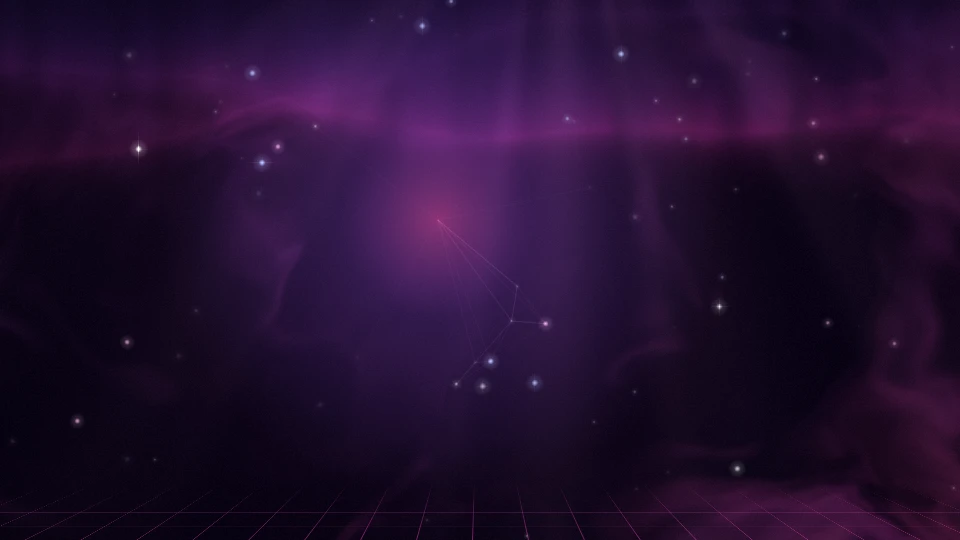
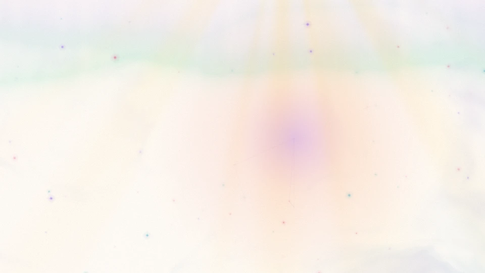
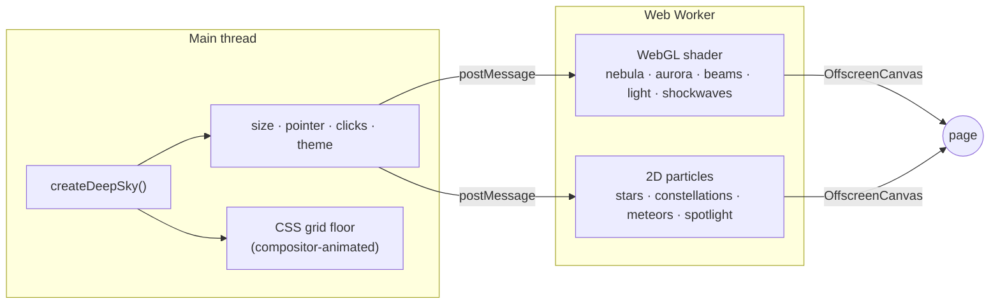

<div align="center">

<a href="https://deep-sky.vercel.app"></a>

# ✦ deep-sky

**Put the universe behind your UI.**

A living, GPU-rendered background for the web: a nebula, northern lights, light beams and stars that react to your cursor.<br />
It renders in a Web Worker, so your app never drops a frame.

**[Live demo & playground](https://deep-sky.vercel.app)** · [Install](#install) · [Frameworks](#frameworks) · [Options](#options) · [How it works](#how-it-works)

[](https://www.npmjs.com/package/deep-sky)
[](#performance)
[](package.json)
[](src/types.ts)
[](LICENSE)

</div>

---

## Highlights

- **Off the main thread.** The shader and the particles run in a Web Worker on an OffscreenCanvas. Your clicks, requests and renders stay instant.
- **Adapts to the device.** It measures its own frame time, lowers its resolution and then its frame rate on slower GPUs, backs off while your page runs long tasks, and pauses when off-screen.
- **Feels alive.** A light follows the cursor, stars swirl around it and link into constellations, clicks send shockwaves through the nebula, shooting stars cross the sky.
- **Fully themeable.** Seven presets, every color and every layer configurable live, with a smooth crossfade between dark and light themes.
- **Works everywhere.** Vanilla JS, React, Vue, Svelte, Angular, a `<deep-sky>` tag or a `<script>` from a CDN. TypeScript types included.
- **Polite by default.** Respects `prefers-reduced-motion`, is hidden from assistive tech, never blocks clicks, and falls back gracefully when WebGL or workers are missing.
- **Small.** 14 kB gzipped, zero dependencies.

## Presets

|  |  |  |
| :--: | :--: | :--: |
| `cosmos` (default) | `aurora` | `ember` |
|  |  |  |
| `abyss` | `synthwave` | `daybreak` (light) |

Plus `graphite`, a quiet monochrome sky for product UIs. Every preset has a dark and a light palette. Build your own in the [playground](https://deep-sky.vercel.app) and copy the generated code.

## Install

```bash
npm install deep-sky
```

Or without a build step:

```html
<script src="https://unpkg.com/deep-sky"></script>
<deep-sky fixed preset="aurora"></deep-sky>
```

## Quick start

```js
import { createDeepSky } from 'deep-sky';

// the whole page
const sky = createDeepSky(document.body);

// or a single section, with options
createDeepSky(document.querySelector('.hero'), {
  preset: 'aurora',
  meteors: { frequency: 2 },
  palette: { dark: { glow: '#7cf3e2' } },
});
```

The background is inserted as the first child of the container, behind its content (`z-index: -1`). When needed, the container gets `position: relative` and `isolation: isolate` so the layer stays above its own background. Content with a transparent background shows the sky; glassy surfaces (`backdrop-filter`) look especially good on top of it.

## Frameworks

<details open>
<summary><b>React</b></summary>

```tsx
import { DeepSky } from 'deep-sky/react';

export function Hero() {
  return (
    <DeepSky preset="aurora" className="hero" onReady={(sky) => sky.pulse()}>
      <h1>Hello, universe</h1>
    </DeepSky>
  );
}
```

Every option is a prop. Props are compared by value, so inline objects don't restart anything.

</details>

<details>
<summary><b>Vue</b></summary>

```vue
<script setup>
import { DeepSky } from 'deep-sky/vue';

const options = { preset: 'aurora' };
</script>

<template>
  <DeepSky :options="options" class="hero" @ready="(sky) => sky.pulse()">
    <h1>Hello, universe</h1>
  </DeepSky>
</template>
```

</details>

<details>
<summary><b>Svelte</b></summary>

```svelte
<script>
  import { deepSky } from 'deep-sky/svelte';
</script>

<section class="hero" use:deepSky={{ preset: 'aurora' }}>
  <h1>Hello, universe</h1>
</section>
```

An action, so it works with Svelte 3, 4 and 5.

</details>

<details>
<summary><b>Angular</b></summary>

A ten-line directive is all it takes:

```ts
import { DestroyRef, Directive, ElementRef, afterNextRender, effect, inject, input } from '@angular/core';
import { createDeepSky, type DeepSkyInstance, type DeepSkyOptions } from 'deep-sky';

@Directive({ selector: '[deepSky]' })
export class DeepSkyDirective {
  readonly options = input<DeepSkyOptions>({}, { alias: 'deepSky' });
  private sky?: DeepSkyInstance;

  constructor() {
    const el: HTMLElement = inject(ElementRef).nativeElement;
    afterNextRender(() => (this.sky = createDeepSky(el, this.options())));
    effect(() => this.sky?.set(this.options(), true));
    inject(DestroyRef).onDestroy(() => this.sky?.destroy());
  }
}
```

```html
<section class="hero" [deepSky]="{ preset: 'aurora' }">…</section>
```

</details>

<details>
<summary><b>Web Component</b></summary>

```html
<script type="module">
  import 'deep-sky/element';
</script>

<section class="hero">
  <deep-sky preset="aurora" theme="light"></deep-sky>
  <h1>Hello, universe</h1>
</section>
```

`<deep-sky>` fills its parent (or the viewport with the `fixed` attribute). Attributes: `preset`, `theme`, `speed`, `animate`, `click`, `quality`, `intro`, `worker`, and one per layer (`nebula="1.5"` sets the intensity, `grid="false"` hides it). Every option is available through the `options` property:

```js
document.querySelector('deep-sky').options = { stars: { density: 2 } };
```

</details>

## Options

Everything is optional. Layers accept `false` (hidden), `true` (shown with the preset's values) or an object (shown, tweaked).

| Option | Type | Default | |
| --- | --- | --- | --- |
| `preset` | `'cosmos' \| 'aurora' \| 'ember' \| 'abyss' \| 'synthwave' \| 'graphite' \| 'daybreak'` or a preset object | `'cosmos'` | Starting point for everything else |
| `theme` | `'dark' \| 'light' \| 'auto'` | preset's, else `'dark'` | `auto` follows `prefers-color-scheme`; changes crossfade |
| `palette` | `{ dark?: Partial<Palette>, light?: Partial<Palette> }` | preset's | See [palette](#palette) |
| `speed` | `number` | `1` | Time multiplier, `0` freezes the motion |
| `animate` | `boolean \| 'auto'` | `'auto'` | `false` renders one still frame; `auto` respects reduced motion |
| `intro` | `boolean` | `true` | Fade-in and rising ring of light on start |
| `click` | `'shockwave' \| 'ring' \| 'none'` | `'shockwave'` | What a click on the background does |
| `clickIgnore` | CSS selector | links, buttons, inputs… | Clicks on these never trigger the effect (also: `data-deep-sky-ignore`) |
| `grain` | `number` | `0.02` | Film grain, 0 to 0.3 |
| `vignette` | `number` | `0.6` | Darkened corners (dark theme) |
| `quality` | `'low' \| 'medium' \| 'high' \| 'ultra'` or object | `'medium'` | See [performance](#performance) |
| `worker` | `boolean \| string \| URL` | `true` | `false` renders on the main thread; a URL loads the worker script from there |
| `fixed` | `boolean` | `true` on `<body>` | Cover the viewport instead of the container |
| `zIndex` | `number` | `-1` | z-index of the layer inside the container |
| `pauseWhenHidden` | `boolean` | `true` | Stop rendering off-screen and in background tabs |
| `yieldToPage` | `boolean` | `true` | Slow down while the page runs long tasks |
| `onStats` | `(stats) => void` | | Every second: `fps`, `shaderFps`, `scale`, `particles`, `mode` |
| `onFallback` | `(mode, reason) => void` | | Called when it falls back to the main thread or to CSS |

### Layers

| Layer | Settings (defaults) |
| --- | --- |
| `nebula` | `intensity` (1), `scale` (1, higher = smaller clouds), `shimmer` (0.22, slow drift towards warm tones) |
| `aurora` | `intensity` (1), `position` (0.7, from 0 = bottom to 1 = top) |
| `rays` | `intensity` (1), `spread` (1, angular density of the beams) |
| `glow` | `intensity` (1, the light that follows the cursor, wandering on its own otherwise), `lens` (1, magnifying effect) |
| `stars` | `density` (1), `size` (1), `twinkle` (1), `parallax` (1), `flares` (true), `speed` (1, upward drift) |
| `meteors` | `frequency` (1, about one every 5 seconds) |
| `grid` | `size` (64 px), `speed` (1), `height` (0.55), `tilt` (64°), `opacity` (0.9) |
| `cursor` | `spotlight` (1), `spotlightRadius` (280), `field` (1, swirl), `fieldRadius` (170), `constellations` (true), `linkDistance` (105). `cursor: false` disables pointer tracking |

### Palette

Any CSS color works (`#hex`, `rgb()`, `hsl()`, `oklch()`, named colors). Tuples merge item by item, so `nebula: [, '#ff6ad5']` only changes the second color.

| Key | Used for |
| --- | --- |
| `background` | Base color, painted before the first frame too |
| `nebula` | `[deep, mid, highlight, accent]` cloud colors |
| `aurora` | `[lower edge, upper fade]` |
| `rays` | Light beams |
| `glow` | Roaming light, shockwaves, light sweeps |
| `stars` | Three star tints |
| `spotlight` | `[center, edge]` of the cursor spotlight |
| `lines` | Constellations and click rings |
| `meteor` | Shooting stars |
| `grid` | Grid lines (alpha is honored) |

```js
createDeepSky(document.body, {
  preset: 'cosmos',
  palette: {
    dark: { nebula: ['#1a0b3d', '#3b0f70', '#ff6ad5', '#ffd166'], glow: '#ff9bd2' },
    light: { background: '#fffaf3' },
  },
});
```

## Instance API

```ts
const sky = createDeepSky(element, options);

sky.set({ theme: 'light' });        // merge options, applied live
sky.set(allOptions, true);          // replace them all
sky.pulse();                        // diagonal light sweep, e.g. on route changes
sky.burst(x, y, 'shockwave');       // click effect at a point (px, relative to the container)
sky.pause();                        // stop the motion (renders a still frame)
sky.play();
sky.destroy();                      // stop, remove the layer, restore the container

sky.mode;    // 'worker' | 'main-thread' | 'css' | 'pending'
sky.ready;   // Promise, resolved after the first frame
sky.element; // the background layer
```

Also exported: `presets`, `presetNames`, `defaults`, `qualities`, `normalizeOptions()` (every default applied, handy for building UIs) and `mergeOptions()`.

## Recipes

**A light sweep on every route change**

```js
router.afterEach(() => sky.pulse()); // Vue Router, or any router event
```

**Follow the system theme**

```js
createDeepSky(document.body, { theme: 'auto' });
```

**A still background (print, screenshots, battery saving)**

```js
createDeepSky(document.body, { animate: false });
```

**Strict Content Security Policy.** The worker starts from a Blob URL, which needs `worker-src blob:`. If that's not an option, serve the bundled worker yourself:

```js
import workerUrl from 'deep-sky/worker?url'; // Vite; or copy node_modules/deep-sky/dist/worker.iife.js

createDeepSky(document.body, { worker: workerUrl });
```

## How it works



- **The shader** layers a domain-warped fractal noise nebula ([technique](https://iquilezles.org/articles/warp/)), three aurora curtains with vertical streaks, swaying light beams, a light that follows the cursor through a small lens, up to four simultaneous shockwaves, a light sweep, grain and a vignette. A nebula is soft by nature, so it renders at half resolution and 30 fps, then gets upscaled.
- **The particle layer** draws stars at different depths (parallax), a magnetic swirl around the cursor, constellation lines, shooting stars and a spotlight, all from pre-rendered sprites.
- **The grid** is plain CSS: a perspective plane animated by the compositor, so it costs nothing.
- **Fallbacks:** worker + OffscreenCanvas, then the same engine on the main thread (loaded on demand), then CSS gradients when WebGL is missing. Lost WebGL contexts are restored.

## Performance

| Quality | Shader resolution | Shader fps | Particle pixel ratio | Adaptive |
| --- | --- | --- | --- | --- |
| `low` | 0.35× | 24 | 1 | yes |
| `medium` (default) | 0.5× | 30 | 1.5 | yes |
| `high` | 0.75× | 60 | 2 | yes |
| `ultra` | 1× | 60 | 2 | no |

Particles run at 60 fps while the cursor moves and 30 fps at rest (always 60 on `high` and `ultra`). When frames get slow, the adaptive mode lowers the shader resolution down to `minScale`, then its frame rate. A long task on your page (big render, heavy JSON…) makes it back off for two seconds. Nothing renders while the sky is off-screen or the tab is hidden.

Size: 14 kB gzipped for the default entry, worker included. The main-thread engine (7 kB) is only downloaded when a fallback needs it.

## Browser support

| Browser | Rendering |
| --- | --- |
| Chrome, Edge · Firefox 105+ · Safari 17+ | Web Worker |
| Safari 15–16 | Main thread |
| No WebGL | CSS gradients + particles |

## FAQ

**Does it work with SSR (Next.js, Nuxt, SvelteKit, Astro, Angular SSR)?** Yes. Importing is safe on the server; the components and the action only start in the browser. With the core API, call `createDeepSky` after mount.

**My content hides the background.** The layer sits behind the container's content, so any opaque background on that content covers it. Make those backgrounds transparent or translucent.

**Can I put it behind my whole app?** Yes: `createDeepSky(document.body)`. The layer is `position: fixed` and ignores pointer events.

## Development

```bash
npm install
npm run dev          # demo and playground on http://localhost:5173
npm test             # unit tests
npm run build        # library → dist/
npm run build:demo   # site → demo/dist
npm run capture      # README images and social card (needs a local Chrome)
```

Contributions are welcome, see [CONTRIBUTING.md](CONTRIBUTING.md).

## License

[MIT](LICENSE) © 2026 Raphael Pellerin
